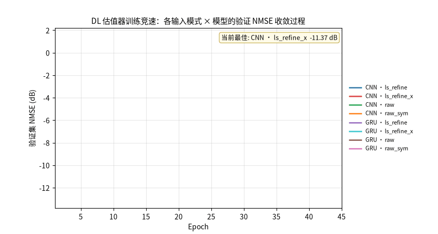

<div align="center">

# Channel-Estimation-Methods-Comparison-Framework

**Classical and deep-learning channel estimation compared in one pipeline, with one metric implementation**

[](https://github.com/ygxiuming/Channel-Estimation-Methods-Comparison-Framework/actions)
[](pyproject.toml)
[](https://github.com/astral-sh/uv)
[](LICENSE)

[简体中文](README.md) ｜ English

</div>

---

Deep-learning channel estimation papers are usually compared against classical baselines under each paper's own protocol: different datasets, different metric implementations, different training setups. Results stop being reproducible. This repository puts every method into **one pipeline** — identical Rayleigh channel samples, identical pilot structure, identical three-trial evaluation with confidence intervals — so LS / LMMSE / ML race CNN / RNN / LSTM / GRU / Hybrid / LmmseNet under exactly the same conditions.

One full run takes minutes and produces NMSE/BER curves, heatmaps, and an auto-written comparison report. Current headline: LMMSE remains the ceiling on the classical side (NMSE -35.05 dB @ 30 dB SNR), while on the deep-learning side the gap to LMMSE has been cut from **23.9 dB to 11.7 dB** by two input-mode fixes plus the model-driven LmmseNet.


## Key findings

All numbers below come from artifacts stored in this repository; the full reports are listed in the [artifact index](#artifact-index).

**1. End-to-end `raw` inputs prevent sequence models from learning; per-pilot-symbol layout fixes it (A/B measured)**

The concatenated `raw` layout destroys RNN receptive-field locality — after a full training run, GRU NMSE stays near 1.0, i.e. it learned nothing. Regrouping inputs per pilot symbol (`raw_sym`) drops GRU@30 dB NMSE from `9.94e-01` to `1.79e-01`, a **7.4 dB** improvement in NMSE(dB). In the race plot below, `raw` runs get early-stopped within 11–12 epochs while `raw_sym` converges normally:



**2. `ls_refine` lacks pilot context, so CNN over-corrects a good LS estimate at high SNR**

LS already reaches -34.9 dB at 30 dB SNR, yet a CNN fed only with the LS estimate drags it down to -11.1 dB — with nothing to anchor on, the network edits blindly. Exposing pilot features (`ls_refine_x`) restores it to **-17.7 dB (+6.5 dB)**.

**3. LmmseNet: model-driven unfolding halves the DL-to-LMMSE gap**

LmmseNet explicitly executes the per-sample LMMSE complex filter inside the forward pass (`R·(R + r·(XXᴴ)⁻¹)⁻¹`, with learnable global scalars `R` and `r`, the latter being an equivalent noise variance), while a correction head — initialized to zeros — learns only the residual the physics layer cannot cover. Because the physics layer makes the starting point exactly LMMSE, the "model learns nothing" failure mode is ruled out. Head-to-head against GRU under identical conditions: NMSE `4.59e-03` vs `1.68e-02` at 30 dB (**+5.7 dB**), shrinking the gap to LMMSE to **11.7 dB**; it beats GRU across 5–30 dB and ties at low SNR.

| SNR | LmmseNet | GRU(ls_refine_x) | LMMSE (reference) |
|:---:|:---:|:---:|:---:|
| 0 dB | 2.75e-01 | 2.57e-01 | **2.46e-01** |
| 15 dB | **1.31e-02** | 2.47e-02 | 9.76e-03 |
| 30 dB | **4.59e-03** | 1.68e-02 | 3.13e-04 |

## Methods

| Category | Method | Notes |
|---|---|---|
| Classical | LS | Regularized least squares (pseudo-inverse) |
| Classical | LMMSE | Per-sample filtering; noise variance supports oracle / blind (LS-residual based) |
| Classical | ML | Maximum likelihood (LS-ZF equivalent, kept as reference) |
| Deep learning | CNN / RNN / LSTM / GRU | Trainable on any of the four input modes |
| Deep learning | Hybrid | 1D CNN + LSTM encoder-decoder |
| Deep learning | **LmmseNet** | Model-driven unfolding with an embedded LMMSE physics layer; requires the `ls_refine_x` mode |

Four input features are available for the deep models: `raw` (per-pilot concatenation), `raw_sym` (regrouped per pilot symbol, fixing RNN locality), `ls_refine` (real/imag LS estimate), and `ls_refine_x` (plus pilot features). The two improved modes are the defaults; the legacy modes remain configurable for A/B reproduction.

## Getting started

Requires Python 3.12 and [uv](https://docs.astral.sh/uv/). CUDA is optional; everything runs on CPU.

```bash
git clone https://github.com/ygxiuming/Channel-Estimation-Methods-Comparison-Framework.git
cd Channel-Estimation-Methods-Comparison-Framework

uv sync                 # installs Python 3.12 and all dependencies (locked by uv.lock)
uv run python main.py --config src/config/smoke.yml --device cpu    # ~1 min smoke test
uv run python main.py --config src/config/default.yml --device cuda # full experiment
uv run pytest tests/ -q  # 35 tests
```

## CLI

<!-- markdownlint-disable MD013 -->

```text
--config PATH           config file (default src/config/default.yml)
--device cpu|cuda       override the configured device
--seed N                override the random seed
--resume                skip combinations that already have weights/best.pt (resume runs)
--set KEY=VALUE         override any config item, dotted path, repeatable
--replot RESULTS_JSON   regenerate every plot and report from results_*.json, no training
```

<!-- markdownlint-enable MD013 -->

Examples:

```bash
uv run python main.py --set channel.n_tx=8 --set dl.models='[CNN, GRU, LmmseNet]'
uv run python main.py --set traditional.lmmse.noise_var_estimation=blind
uv run python main.py --resume            # continue an interrupted run, or re-evaluate with old weights
uv run python main.py --replot results/results_20261017_200009.json
```

## Artifact index

| Artifact | Contents |
|---|---|
| [results/REPORT_20261017_200009.md](results/REPORT_20261017_200009.md) | Input-mode A/B comparison (CNN+GRU × 4 modes × 7 SNRs); source of findings 1 and 2 |
| [results/REPORT_20261017_202104.md](results/REPORT_20261017_202104.md) | LmmseNet first validation against GRU; source of finding 3 |
| `results/summary_*.csv` / `results/results_*.json` | Full numbers of every run (replayable via `--replot`) |
| `plots/*.png`, `plots/animations/*.gif` | Curves, heatmaps, and the training-race animation |

Each run writes its own timestamped directory; results and figures are committed with the repository so experiments stay reproducible.

## Configuration

Everything lives in `src/config/*.yml` ([default.yml](src/config/default.yml) is fully commented). Core fields:

| Field | Meaning | Default |
|---|---|---|
| `channel.*` | n_tx / n_rx / pilots / SNR list / sample count | 4×4, 16 pilots, 0–30 dB, 10k samples |
| `data.*` | augmentation and train/val/test split | augmentation off (fair protocol) |
| `traditional.lmmse.noise_var_estimation` | `oracle` (true variance) or `blind` (LS residual) | oracle |
| `dl.input_modes` | input modes in play | `['raw_sym', 'ls_refine_x']` |
| `dl.models` | models in play | all six (invalid model×mode pairs are skipped automatically) |
| `training.epochs` / `early_stopping.patience` | training protocol, identical for all methods | 100 / 10 |

## Repository layout

```text
├── main.py                     # entry point
├── pyproject.toml / uv.lock    # uv project definition and locked dependencies
├── .github/workflows/ci.yml    # GitHub Actions CI (pytest + smoke)
├── scripts/
│   ├── release.sh              # release automation (Google-style bilingual notes)
│   ├── extract_commits.sh      # conventional-commit extraction and grouping
│   ├── render_training_race.py # training-race GIF renderer
│   └── RELEASE_NOTES_TEMPLATE.md
├── src/
│   ├── config/                 # default / smoke / ab_validation configs
│   ├── traditional/estimators.py    # LS / LMMSE / ML + blind noise-variance estimation
│   ├── deep_learning/models.py      # CNN/RNN/LSTM/GRU/Hybrid/LmmseNet
│   └── utils/                  # data generation, features, trainer, complex metrics, plots, reports
├── tests/                      # 35 pytest cases, incl. LmmseNet physics-layer equivalence proof
├── results/  plots/            # experiment artifacts (committed)
└── README.md                   # 简体中文版
```

## Tests and CI

`uv run pytest tests/ -q` covers estimator numerics (21 cases), input-feature and blind-noise-variance regression, and the key LmmseNet property: with the correction head zeroed and the true noise variance given, the output matches the analytical LMMSE element-wise. CI runs the same suite plus a CPU smoke experiment on every push / pull request.

## Releases

Release automation is built in (Google-style bilingual notes template):

```bash
bash scripts/release.sh --prepare                        # version inference + notes scaffold
# polish release-notes/vX.Y.Z.md following the template
bash scripts/release.sh --notes release-notes/vX.Y.Z.md  # create and verify the release
```

## Roadmap

- [x] Four input modes with A/B measurements (v0.2.0)
- [x] Blind noise-variance estimation for LMMSE (v0.2.0)
- [x] LmmseNet model-driven unfolding (v0.3.0)
- [x] `--resume` / `--set` / `--replot` CLI engineering and CI (v0.3.0)
- [x] Release automation (v0.3.0)
- [ ] Attention / multi-layer unfolding correction head (go after the remaining 11.7 dB gap)
- [ ] Orthogonal pilots (DFT / Hadamard) configuration and larger training pools
- [ ] OFDM frequency-selective channels, where DL has real headroom

## FAQ

**No CUDA?** Everything runs on CPU — add `--device cpu`.

**Boxes instead of Chinese glyphs in plots?** `utils/plotting.py` auto-detects installed CJK fonts; on Ubuntu, `sudo apt install fonts-noto-cjk`.

**Why oracle noise variance for LMMSE?** It is the common convention for classical baselines. A `blind` variant is one config switch away, and both results are preserved in the artifacts.

**Different channel model?** `channel.type` supports Rayleigh (default); see the config comments for the Rician parameter `rician_k`.

## License

[MIT](LICENSE) © Xiu Ming
