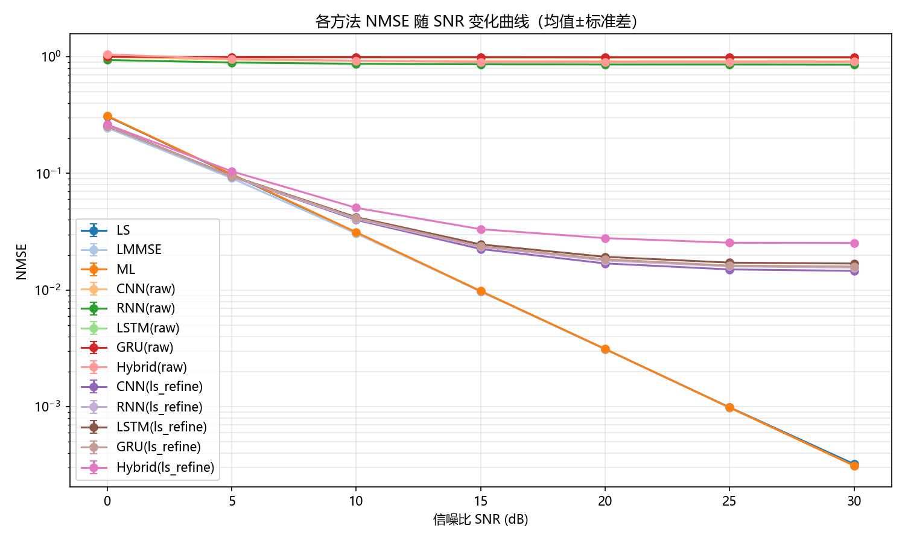
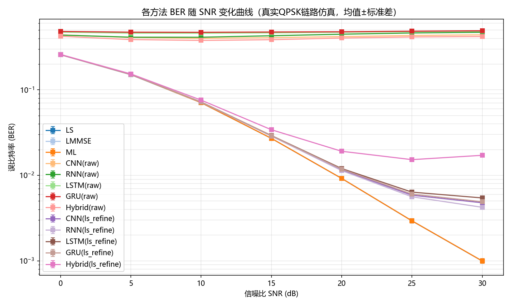
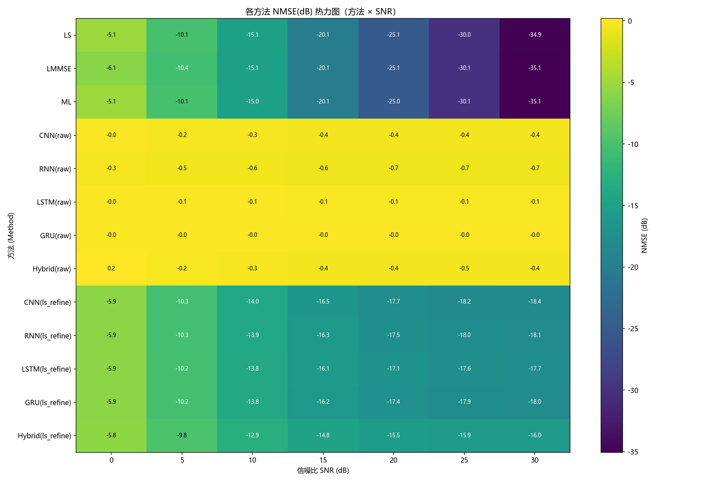
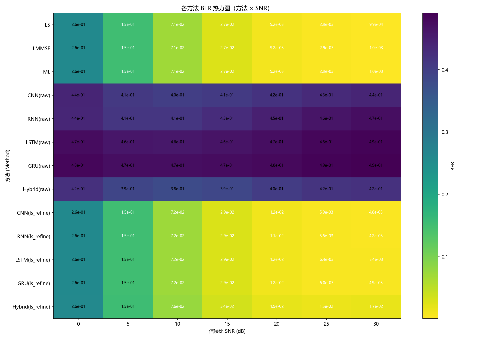
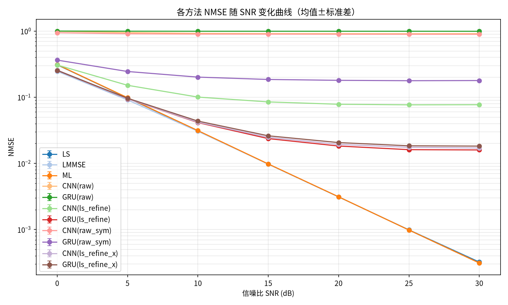
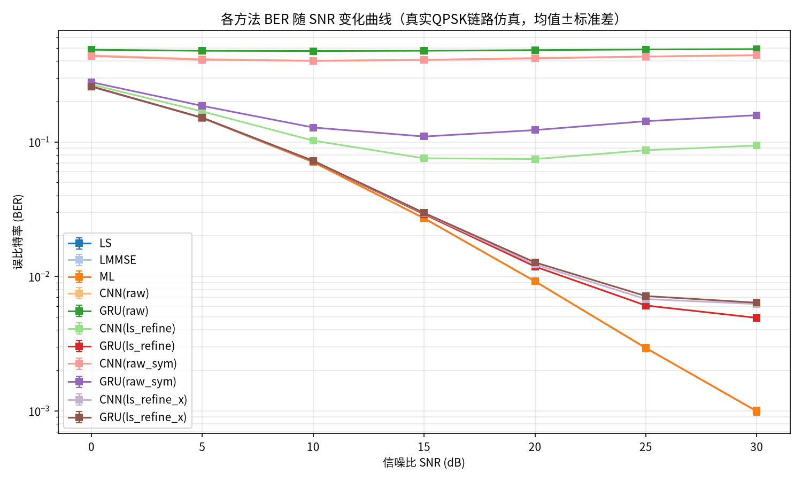
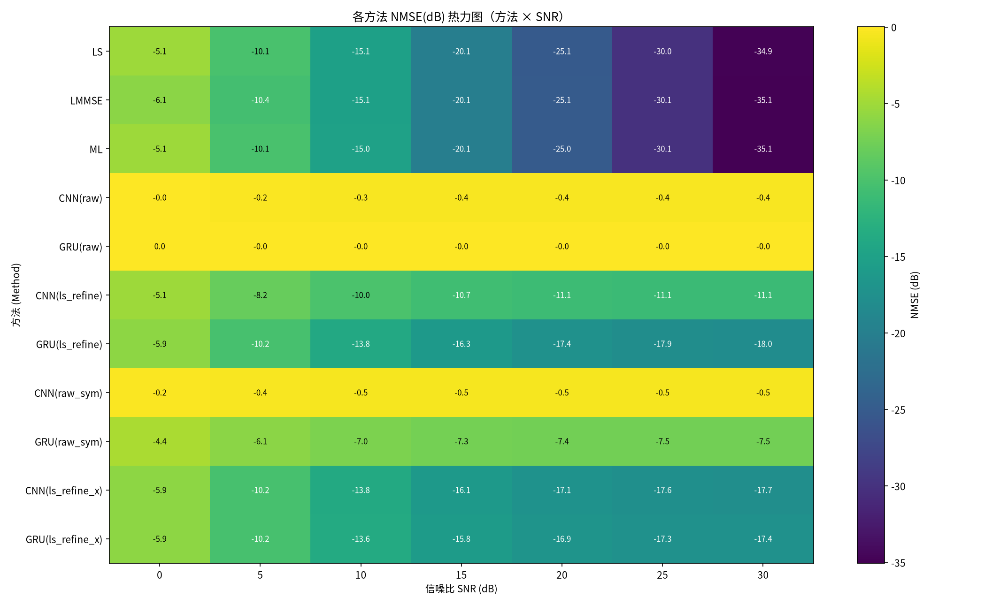
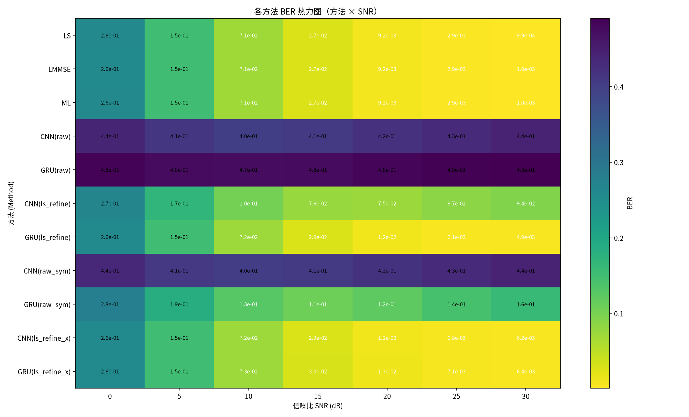

# 信道估计方法对比框架 (Channel Estimation Methods Comparison Framework)

一个基于 PyTorch 的 MIMO 信道估计方法对比实验框架，在系统模型 **Y = H·X + N** 下，
对传统估计方法（LS / LMMSE / ML）与深度学习方法（CNN / RNN / LSTM / GRU / Hybrid）
进行**严格公平**的性能对比，并自动生成对比分析图表与实验报告。

## ✨ 特性 (Features)

- **严谨的方法论**
  - SNR 扫描（默认 0~30 dB）× Monte Carlo 多次重复，报告 **均值 ± 标准差**
  - 所有方法共用同一份测试数据、同一套指标口径（复数域 MSE/NMSE）
  - BER 通过**真实 QPSK 调制 → 信道 → AWGN → 均衡 → 判决**链路仿真获得
  - 评估数据每次独立新生成，LMMSE 协方差仅从训练集估计，**无数据泄漏**
- **四种 DL 输入模式**（独立成组对比；两种改进模式修复了信息缺失问题）
  - `raw`：块拼接（历史方式），`[Re(Y)|Im(Y)|Re(X)|Im(X)]` 四大块顺序展平
  - `raw_sym`：**按导频符号重排（改进，默认）**——每个时间步 = 同一导频符号上的
    `(y, x)` 配对，修复 CNN/RNN 局部感受野看不到配对结构的缺陷
  - `ls_refine`：混合式（历史方式），仅输入 LS 估计的实虚部
  - `ls_refine_x`：**混合式 + 导频特征（改进，默认）**——追加 `[Re(X), Im(X)]`，
    网络可见逐样本噪声协方差 `noise_var·(XXᴴ)⁻¹`，修复高 SNR 处过度收缩的偏差
- **LMMSE 噪声方差来源可选**
  - `oracle`：使用数据生成器真实值（历史默认，便于与旧结果对比）
  - `blind`：由 LS 残差**盲估计**，不使用上帝信息，先验条件与 DL 对齐
- **uv 一键环境**：`uv sync` 自动准备 Python 3.12 与全部依赖，按 `uv.lock` 锁定可复现
- **YOLO 风格训练体验**
  - 逐 epoch 表格输出（训练损失 / 验证损失 / 验证 NMSE(dB) / 学习率）
  - `weights/best.pt` + `weights/last.pt` 权重保存
  - `results.csv` 逐轮日志 + `results.png` 自动训练曲线
  - 早停 (EarlyStopping) + 学习率自适应 (ReduceLROnPlateau)
- **全中文输出**：控制台、图表、报告均为中文（英文以 `()` 标注），
  自动探测中文字体解决绘图乱码
- **自动化报告**：实验结束后自动生成 Markdown 实验报告（结果总表、
  对比分析、结论、图表引用）
- **完善测试**：pytest 覆盖估计器正确性、输入特征构造、盲噪声方差估计等核心算法

## 📁 目录结构 (Project Structure)

```
├── main.py                     # 主程序入口（仓库根目录）
├── pyproject.toml              # uv 项目定义（依赖 / dev 组）
├── uv.lock                     # uv 依赖锁定（精确版本，保证复现）
├── .python-version             # 固定 Python 3.12
├── requirements.txt            # pip 备用（由 uv export 生成）
├── src/
│   ├── config/
│   │   ├── default.yml         # 默认配置（完整实验）
│   │   ├── smoke.yml           # 冒烟配置（小规模快速验证）
│   │   └── ab_validation.yml   # 输入模式 A/B 对照配置（v0.2.0 验证）
│   ├── traditional/
│   │   └── estimators.py       # LS / LMMSE / ML 估计器 + 复数域指标 + 盲噪声方差估计
│   ├── deep_learning/
│   │   └── models.py           # CNN/RNN/LSTM/GRU/Hybrid（维度参数化）
│   └── utils/
│       ├── config.py           # 配置加载器
│       ├── data_generator.py   # 信道/导频/接收信号生成（含噪声方差）
│       ├── features.py         # DL 输入特征构造（四种输入模式）
│       ├── preprocessing.py    # 全局一致缩放 + 物理一致同步增强
│       ├── ber.py              # 真实 QPSK 链路 BER 仿真
│       ├── plotting.py         # 中文字体配置 + CJK 终端对齐
│       ├── report.py           # 自动对比分析 + Markdown 报告生成
│       └── trainer.py          # YOLO 风格训练器
├── tests/
│   ├── test_estimators.py      # 21 项合理性测试
│   └── test_features.py        # 输入特征 + 盲噪声方差回归测试
├── requirements.txt
└── README.md
```

## 🚀 快速开始 (Quick Start)

### 1. 环境配置

```bash
# 方式一（推荐）：uv 一键同步——自动准备 Python 3.12 与全部依赖（按 uv.lock 锁定）
uv sync

# 方式二：传统 venv + pip
python -m venv venv
source venv/bin/activate      # Linux / macOS
.\venv\Scripts\activate       # Windows

pip install -r requirements.txt
```

### 2. 运行实验

```bash
# 冒烟验证（几分钟内跑通全流程，建议先跑这个）
uv run python main.py --config src/config/smoke.yml --device cpu

# 完整实验（默认配置：7 个 SNR × 5 种 DL 模型 × 2 种输入模式）
uv run python main.py

# 指定配置文件 / 设备 / 随机种子
uv run python main.py --config src/config/default.yml --device cuda --seed 42
```

### 3. 运行测试

```bash
uv run pytest tests/ -q
```

## 🖥️ 输出示例 (Sample Output)

启动时打印初始化参数面板：

```
  +------------------------+------------------------------------------+
  | 配置文件 (Config)      | src/config/default.yml                   |
  | 信道 (Channel)         | rayleigh  4发×4收, 16 导频               |
  | SNR扫描 (SNR sweep)    | [0, 5, 10, 15, 20, 25, 30] dB            |
  | DL输入模式 (DL inputs) | raw_sym, ls_refine_x                       |
  | ...                    | ...                                      |
  +------------------------+------------------------------------------+
```

训练过程（YOLO 风格，验证集 NMSE(dB) 类比 YOLO 的 mAP）：

```
模型概况 (Model summary): 参数量 198,305, 设备=cpu, 批大小=128, 学习率=0.001, 轮数=100

轮次(Epoch) 训练损失(train_loss) 验证损失(val_loss) 验证NMSE(dB)   学习率(lr)
   1/100           0.51600           0.50653         0.01dB    1.00e-03  [2.1s]
   2/100           0.31244           0.29871        -2.32dB    1.00e-03  [2.0s]
   ...

早停 (EarlyStopping): 连续 10 轮验证损失无改善，训练提前结束。
训练完成 (Training completed)，耗时 0.012 小时。
结果已保存至 (Results saved to): results/channel_estimation_cnn_raw
```

每个 SNR 评估完成后打印结果表格：

```
  SNR = 20 dB, 3 次重复 × 2000 测试样本:
  方法 (Method)              NMSE     NMSE(dB)      误比特率 (BER)
  --------------------------------------------------------------
  LS                   3.3239e-03       -24.78       8.6719e-03
  LMMSE                3.3301e-03       -24.78       8.6816e-03
  CNN(ls_refine)       3.2333e-01        -4.90       1.6353e-01
  ...
```

## 📦 输出产物 (Outputs)

实验完成后，结果目录结构如下：

```
results/  (或配置中的 save_dir)
├── REPORT_<时间戳>.md          # 📄 最终实验报告（结果总表/对比分析/结论/图表）
├── results_<时间戳>.json       # 结构化结果（方法 × SNR × trial）
├── summary_<时间戳>.csv        # 汇总表（均值±标准差）
├── logs/experiment_*.log       # 完整实验日志
└── <实验名>_<模型>_<模式>/      # 每个 DL 模型的独立目录（YOLO 风格）
    ├── weights/best.pt         # 验证损失最优权重
    ├── weights/last.pt         # 最后一轮权重
    ├── results.csv             # 逐 epoch: train_loss/val_loss/val_nmse_db/lr
    └── results.png             # 训练曲线（损失 + NMSE + 学习率）

plots/  (或配置中的 plot_dir)
├── nmse_vs_snr_*.png           # NMSE-SNR 曲线（均值±标准差）
├── ber_vs_snr_*.png            # BER-SNR 曲线（均值±标准差）
├── nmse_heatmap_*.png          # NMSE 方法×SNR 热力图 (dB)
└── ber_heatmap_*.png           # BER 方法×SNR 热力图
```

## 📊 实验结果 (Results)

以下为默认配置（4×4 MIMO Rayleigh 信道、16 导频、训练池 10000 样本、
每 SNR 点 2000 测试样本 × 3 次 Monte Carlo 重复、种子 42）的一次完整实验结果。
完整数据（含标准差）见 [results/REPORT_20260726_160023.md](results/REPORT_20260726_160023.md)。

> **注意**：下表结果由 **历史输入模式**（`raw` / `ls_refine` 块拼接 + LMMSE
> oracle 噪声方差）生成（保留用于方法学对照）。当前默认已切换为改进模式
> `raw_sym` / `ls_refine_x`（见上 ✨ 特性），修复效果已实测——
> 详见下方 **「输入模式 A/B 对照验证」** 小节。

### NMSE-SNR 曲线（均值±标准差）



### BER-SNR 曲线（真实 QPSK 链路仿真）



### NMSE / BER 热力图（方法 × SNR）




### NMSE 结果（各 3 次重复均值，越小越好）

| 方法 | 0 dB | 5 dB | 10 dB | 15 dB | 20 dB | 25 dB | 30 dB |
|---|---|---|---|---|---|---|---|
| **LMMSE** | **2.46e-01** | **9.10e-02** | **3.06e-02** | 9.76e-03 | 3.12e-03 | **9.83e-04** | **3.13e-04** |
| LS | 3.09e-01 | 9.77e-02 | 3.11e-02 | **9.76e-03** | **3.12e-03** | 9.89e-04 | 3.23e-04 |
| ML | 3.12e-01 | 9.85e-02 | 3.13e-02 | 9.82e-03 | 3.13e-03 | 9.84e-04 | 3.13e-04 |
| CNN(raw) | 9.95e-01 | 9.45e-01 | 9.23e-01 | 9.20e-01 | 9.16e-01 | 9.15e-01 | 9.16e-01 |
| RNN(raw) | 9.38e-01 | 8.93e-01 | 8.70e-01 | 8.61e-01 | 8.59e-01 | 8.58e-01 | 8.56e-01 |
| LSTM(raw) | 9.98e-01 | 9.87e-01 | 9.85e-01 | 9.82e-01 | 9.81e-01 | 9.81e-01 | 9.81e-01 |
| GRU(raw) | 1.00e+00 | 9.94e-01 | 9.93e-01 | 9.93e-01 | 9.91e-01 | 9.91e-01 | 9.91e-01 |
| Hybrid(raw) | 1.05e+00 | 9.58e-01 | 9.24e-01 | 9.02e-01 | 9.03e-01 | 8.99e-01 | 9.05e-01 |
| CNN(ls_refine) | 2.59e-01 | 9.36e-02 | 3.99e-02 | 2.25e-02 | 1.69e-02 | 1.50e-02 | 1.46e-02 |
| RNN(ls_refine) | 2.56e-01 | 9.36e-02 | 4.06e-02 | 2.34e-02 | 1.79e-02 | 1.60e-02 | 1.56e-02 |
| LSTM(ls_refine) | 2.55e-01 | 9.53e-02 | 4.21e-02 | 2.46e-02 | 1.93e-02 | 1.72e-02 | 1.69e-02 |
| GRU(ls_refine) | 2.55e-01 | 9.50e-02 | 4.14e-02 | 2.37e-02 | 1.84e-02 | 1.62e-02 | 1.59e-02 |
| Hybrid(ls_refine) | 2.62e-01 | 1.04e-01 | 5.07e-02 | 3.33e-02 | 2.79e-02 | 2.55e-02 | 2.54e-02 |

### BER 结果（真实 QPSK 链路仿真，各 3 次重复均值，越小越好）

| 方法 | 0 dB | 5 dB | 10 dB | 15 dB | 20 dB | 25 dB | 30 dB |
|---|---|---|---|---|---|---|---|
| **LMMSE** | **2.58e-01** | **1.50e-01** | **7.07e-02** | **2.70e-02** | **9.20e-03** | **2.94e-03** | **9.96e-04** |
| LS | 2.59e-01 | 1.51e-01 | 7.09e-02 | 2.71e-02 | 9.20e-03 | 2.94e-03 | 9.94e-04 |
| ML | 2.59e-01 | 1.51e-01 | 7.09e-02 | 2.71e-02 | 9.21e-03 | 2.94e-03 | 9.96e-04 |
| RNN(ls_refine) | 2.58e-01 | 1.51e-01 | 7.18e-02 | 2.88e-02 | 1.14e-02 | 5.61e-03 | 4.23e-03 |
| CNN(ls_refine) | 2.58e-01 | 1.51e-01 | 7.20e-02 | 2.89e-02 | 1.16e-02 | 5.86e-03 | 4.78e-03 |
| GRU(ls_refine) | 2.58e-01 | 1.51e-01 | 7.21e-02 | 2.91e-02 | 1.18e-02 | 6.04e-03 | 4.91e-03 |
| LSTM(ls_refine) | 2.58e-01 | 1.51e-01 | 7.22e-02 | 2.92e-02 | 1.20e-02 | 6.36e-03 | 5.44e-03 |
| Hybrid(ls_refine) | 2.60e-01 | 1.54e-01 | 7.59e-02 | 3.42e-02 | 1.91e-02 | 1.53e-02 | 1.72e-02 |
| Hybrid(raw) | 4.24e-01 | 3.88e-01 | 3.79e-01 | 3.86e-01 | 4.04e-01 | 4.16e-01 | 4.21e-01 |
| CNN(raw) | 4.40e-01 | 4.10e-01 | 4.00e-01 | 4.08e-01 | 4.20e-01 | 4.33e-01 | 4.41e-01 |
| RNN(raw) | 4.38e-01 | 4.13e-01 | 4.13e-01 | 4.30e-01 | 4.48e-01 | 4.63e-01 | 4.72e-01 |
| LSTM(raw) | 4.74e-01 | 4.61e-01 | 4.60e-01 | 4.64e-01 | 4.73e-01 | 4.82e-01 | 4.87e-01 |
| GRU(raw) | 4.82e-01 | 4.73e-01 | 4.72e-01 | 4.75e-01 | 4.78e-01 | 4.86e-01 | 4.91e-01 |

### 主要结论 (Key Findings)

1. **传统方法**：LMMSE 在全部 SNR 点不劣于 LS（低 SNR 处增益约 1 dB，
   高 SNR 趋于一致），符合理论预期；ML 与 LS 基本重合（线性高斯模型下
   ML 等价于无正则 LS 的闭式解）。
2. **DL 两种输入模式差异显著**：`ls_refine` 模式（最优 CNN(ls_refine)，
   30 dB 时 NMSE 1.46e-02）远优于 `raw` 端到端模式（最优 RNN(raw)，
   NMSE 8.56e-01）——混合式输入把"解线性方程"的难题交给 LS，
   网络只需学习去噪，显著降低学习难度。
3. **DL vs 传统**：当前配置下 DL 方法在 0 dB 低 SNR 处已接近 LMMSE
   （差距仅 0.15 dB），但高 SNR 处仍有差距（30 dB 处约 16.7 dB）。
   该任务是低维线性逆问题，LMMSE 在已知统计特性下是最优线性估计；
   DL 的潜力需要更复杂的信道模型（非线性损伤、硬件非理想等）才能发挥。
4. **方法论保障**：所有方法在相同测试数据、相同指标口径
   （复数域 NMSE + 真实 QPSK 链路 BER）下评估，每 SNR 点 3 次独立重复，
   结果具有统计意义。

### 输入模式 A/B 对照验证（v0.2.0 修复实测，2026-10-17）

**目的**：在同条件下量化 v0.2.0 两处输入修复的收益——
`raw → raw_sym`（按导频符号重排）与 `ls_refine → ls_refine_x`（追加导频特征）。
四种模式同场训练评估，条件与 `default.yml` 完全一致
（4×4 Rayleigh、16 导频、训练池 10000、每 SNR 2000 测试 × 3 重复、种子 42），
模型取 CNN + GRU 两族覆盖卷积与时序结构，GPU 运行约 3 分钟。
配置见 [src/config/ab_validation.yml](src/config/ab_validation.yml)，
完整数据见 [results/REPORT_20261017_200009.md](results/REPORT_20261017_200009.md)。

### NMSE-SNR 曲线（A/B 对照，均值±标准差）



### BER-SNR 曲线（A/B 对照，真实 QPSK 链路）



### NMSE / BER 热力图（A/B 对照）




### NMSE 结果（各 3 次重复均值，四模式同场对照）

| 方法 | 0 dB | 5 dB | 10 dB | 15 dB | 20 dB | 25 dB | 30 dB |
|---|---|---|---|---|---|---|---|
| LMMSE | **2.46e-01** | **9.10e-02** | **3.06e-02** | 9.76e-03 | 3.12e-03 | **9.83e-04** | **3.12e-04** |
| LS | 3.09e-01 | 9.77e-02 | 3.11e-02 | **9.76e-03** | **3.12e-03** | 9.89e-04 | 3.23e-04 |
| ML | 3.12e-01 | 9.85e-02 | 3.13e-02 | 9.82e-03 | 3.13e-03 | 9.84e-04 | 3.12e-04 |
| CNN(raw) | 9.94e-01 | 9.48e-01 | 9.24e-01 | 9.17e-01 | 9.15e-01 | 9.13e-01 | 9.15e-01 |
| GRU(raw) | 1.01e+00 | 9.96e-01 | 9.95e-01 | 9.95e-01 | 9.94e-01 | 9.95e-01 | 9.94e-01 |
| CNN(ls_refine) | 3.07e-01 | 1.52e-01 | 1.01e-01 | 8.51e-02 | 7.84e-02 | 7.68e-02 | 7.71e-02 |
| GRU(ls_refine) | 2.55e-01 | 9.47e-02 | 4.14e-02 | 2.37e-02 | 1.83e-02 | 1.61e-02 | 1.60e-02 |
| CNN(raw_sym) | 9.44e-01 | 9.11e-01 | 9.01e-01 | 9.00e-01 | 8.97e-01 | 8.96e-01 | 8.95e-01 |
| GRU(raw_sym) | 3.64e-01 | 2.45e-01 | 2.02e-01 | 1.86e-01 | 1.80e-01 | 1.78e-01 | 1.79e-01 |
| CNN(ls_refine_x) | 2.57e-01 | 9.48e-02 | 4.19e-02 | 2.48e-02 | 1.94e-02 | 1.75e-02 | 1.71e-02 |
| GRU(ls_refine_x) | 2.55e-01 | 9.65e-02 | 4.36e-02 | 2.61e-02 | 2.07e-02 | 1.85e-02 | 1.83e-02 |

### A/B 实测结论

1. **`raw → raw_sym`：时序模型被"解锁"**。GRU(raw) 修复前处于"全零估计"水平
   （NMSE≈1.0、BER≈0.5≈QPSK 硬翻转下限），修复后正常学习：
   0 dB 处 NMSE 1.00→3.64e-01（**+4.4 dB**），30 dB 处 9.94e-01→1.79e-01（**+7.4 dB**）。
   CNN 在两种排布下均难从 raw 输入学习（其 1D 卷积 k=3 的感受野难以
   完成 y×x 全局配对）——排布修复对时序模型立竿见影，与机理分析一致。
2. **`ls_refine → ls_refine_x`：CNN 高 SNR 退化被修复**。追加导频特征后，
   CNN 30 dB NMSE 7.71e-02→1.71e-02（**+6.5 dB**，NMSE(dB) 从 -11.1 升至 -17.7），
   追平 GRU 水平；GRU 两模式基本持平（-18.0 vs -17.4 dB，在重复方差内无差异）。
   修复前 CNN(ls_refine) 将本已 -34.9 dB 的 LS 输入" refining"成 -11.1 dB，
   极端反常——正是"看不见导频 → 学成全局平均收缩 → 过收缩引入偏差"的实锤。
3. **与 LMMSE 的差距**：修复后最佳 DL（CNN(ls_refine_x) 或 CNN(ls_refine) 内
   的最优）在 30 dB 处距 LMMSE（-35.05 dB）约 **17.4 dB**
   （修复前同对照为 23.9 dB）。剩余差距主要来自训练规模与网络容量
   （10000 池 × 轻量网络 vs 理论最优线性滤波），
   后续通过更大训练池/更强架构/展开式模型继续收窄。
4. **跨表可比性提示**：下方历史结果表由另一环境生成（torch 版本不同导致
   训练轨迹不同，如 CNN(ls_refine) 的高 SNR 表现就存在环境敏感波动），
   **不同实验的数字不可直接横比，同一实验表内对照才有效**——这也是本次
   全部对照在同一 run 内完成的原因。

## ⚙️ 配置详解 (Configuration)

完整配置见 `src/config/default.yml` 注释，核心项：

```yaml
channel:
  n_tx: 4                        # 发射天线数
  n_rx: 4                        # 接收天线数
  n_pilot: 16                    # 导频长度（必须 >= n_tx）
  snr_list: [0,5,10,15,20,25,30] # SNR 扫描列表 (dB)
  n_samples: 10000               # 训练池样本数
  type: 'rayleigh'               # 'rayleigh' 或 'rician'
  rician_k: 1.0                  # Rician K 因子

dl:
  input_modes: ['raw_sym', 'ls_refine_x']      # DL 输入模式（含历史模式可切换 A/B）
  models: ['CNN','RNN','LSTM','GRU','Hybrid']  # 可裁剪子集以缩短实验时间

evaluation:
  n_test: 2000                   # 每个 (SNR, trial) 独立生成的测试样本数
  n_trials: 3                    # Monte Carlo 重复次数
  ber_symbols: 100               # BER 仿真每样本每天线的 QPSK 符号数
  equalizer: 'mmse'              # 'zf' 或 'mmse'

traditional:
  ls:
    regularization: true         # 对角加载正则化
    lambda: 0.01
  lmmse:
    correlation_method: 'theoretical'  # 'theoretical'(R_h=I, 无泄漏)
                                       # 或 'sample'(仅从训练集估计)
    # 噪声方差来源：
    # 'oracle' —— 使用数据生成器真实值（历史默认）
    # 'blind'  —— 由 LS 残差盲估计，不使用上帝信息，与 DL 先验条件对齐
    noise_var_estimation: 'oracle'
```

关于 DL 输入模式的完整说明见 `src/config/default.yml` 内注释与
`src/utils/features.py` 模块文档字符串：
`raw`/`raw_sym` 为端到端（后者按导频符号重排，推荐），
`ls_refine`/`ls_refine_x` 为混合式（后者携带导频特征，推荐）。

## 📏 指标定义 (Metrics)

| 指标 | 定义 | 说明 |
|---|---|---|
| MSE | `mean\|H - H_est\|²` | 复数域计算，所有方法口径一致 |
| NMSE | `MSE / mean\|H\|²` | 归一化均方误差，附 dB 值 |
| BER | 真实链路仿真 | QPSK 调制 → 真实信道 → AWGN → 用估计信道均衡 → 判决统计误比特 |

BER 仿真中所有方法使用**相同的比特与噪声种子**，保证对比公平。

## 🔬 实验方法论 (Methodology)

1. **训练池**：信道 H 与导频 X 的分布与 SNR 无关，只生成一次；
   每个 SNR 生成对应的接收信号 Y，合并构成混合 SNR 训练池（一次训练、逐 SNR 测试）
2. **评估**：每个 (SNR, trial) 独立生成全新测试数据；传统方法与全部已训练
   DL 模型在同一份数据上评估
3. **指标口径**：DL 模型输出先重组为复数信道，再走与传统方法完全相同的
   复数域指标与 BER 仿真流程
4. **信息公平**：除历史模式 `ls_refine` 外，各 DL 输入模式均与 LMMSE 一样
   可获得导频 X 的信息（`ls_refine_x` 显式包含）；LMMSE 的噪声方差默认
   取生成器真实值（`oracle`），可配 `blind` 改为由 LS 残差盲估计

## ❓ 常见问题 (FAQ)

- **完整实验要跑多久？** 7 个 SNR × 5 模型 × 2 输入模式在 CPU 上较慢，
  建议使用 GPU，或裁剪 `dl.models` / `dl.input_modes` / `channel.snr_list`
- **图表中文乱码？** 框架会自动探测微软雅黑/苹方/Noto 等中文字体；
  若系统无任何中文字体，请安装后重试（会有提示）
- **TensorBoard 不可用？** 在非 ASCII 路径等环境下会自动降级，不影响训练
- **为什么 DL 暂时不如 LMMSE？** 该任务是低维线性逆问题，LMMSE 是已知
  统计特性下的最优线性估计。此外注意两个历史问题已在新版本修复：
  `raw` 模式的块拼接使 CNN/RNN 局部感受野看不到 (y,x) 配对，
  `ls_refine` 模式看不到导频 X 导致高 SNR 过度收缩——
  请使用改进模式 `raw_sym` / `ls_refine_x` 再评估 DL 的真实水平

## 📄 许可证 (License)

本项目基于 [MIT License](LICENSE) 开源。

## 👤 作者 (Author)

- 修明
- 邮箱：lzmpt@qq.com
