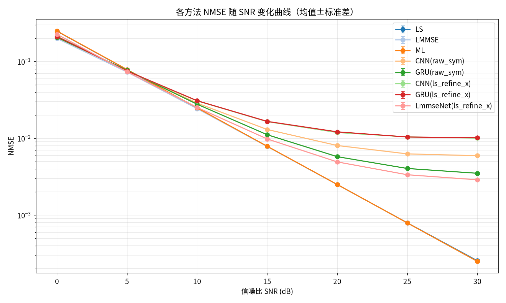
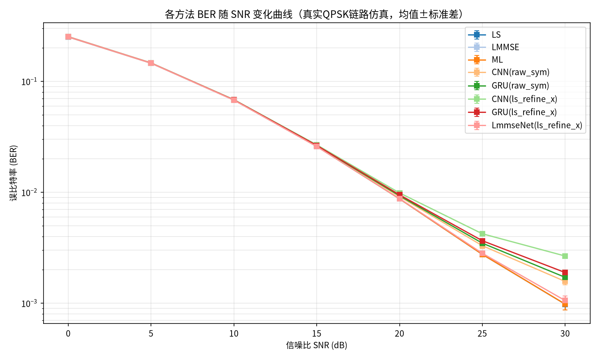
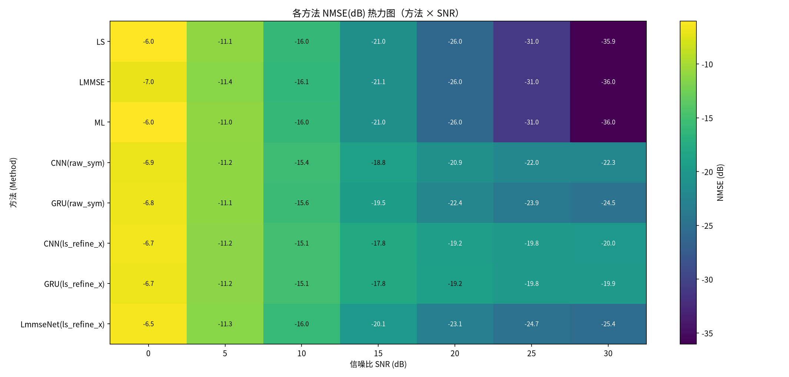
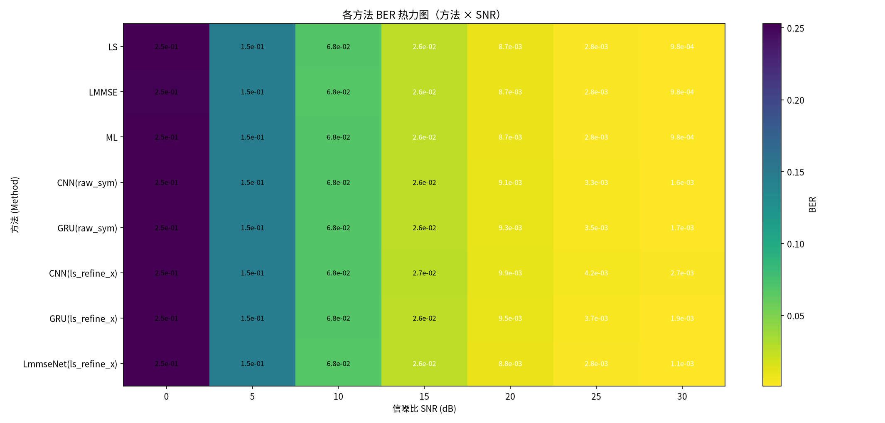

# 信道估计方法对比实验报告

- 生成时间：2026-10-17 21:54:49
- 实验名称：orthogonal_pilots
- 随机种子：42

## 1. 实验配置

| 参数 | 值 |
|---|---|
| 信道类型 (Channel) | rayleigh |
| MIMO 规模 | 4 发 × 4 收 |
| 导频长度 (Pilots) | 16 |
| SNR 扫描 | [0, 5, 10, 15, 20, 25, 30] dB |
| 训练池样本 | 50000 |
| 每点测试样本 | 2000 |
| Monte Carlo 次数 | 3 |
| BER 仿真符号数 | 100 |
| 均衡方式 | mmse |
| DL 输入模式 | raw_sym, ls_refine_x |
| DL 模型 | CNN, GRU, LmmseNet |
| 训练轮数 | 100 （早停 patience=10）|

## 2. 对比方法

**传统方法**：LS（最小二乘）、LMMSE（线性最小均方误差）、ML（最大似然，闭式解）

**深度学习方法**（各输入模式分别成组）：
- `ls_refine_x`：混合式：LS 估计 + 导频特征，网络可见噪声协方差信息（改进）
- `raw_sym`：端到端按导频符号重排：每时间步 = (y, x) 配对（改进）

## 3. 结果总表

### 3.1 NMSE（均值±标准差，越小越好）

| 方法 | 0 dB | 5 dB | 10 dB | 15 dB | 20 dB | 25 dB | 30 dB |
|---|---|---|---|---|---|---|---|
| LS | 2.484e-01±1.6e-03 | 7.840e-02±3.3e-04 | 2.485e-02±1.0e-04 | 7.855e-03±3.6e-06 | 2.500e-03±6.9e-06 | 7.941e-04±1.5e-06 | 2.546e-04±6.8e-07 |
| LMMSE | 2.001e-01±1.2e-03 | 7.304e-02±4.8e-04 | 2.438e-02±8.8e-05 | 7.831e-03±6.1e-06 | 2.500e-03±6.9e-06 | 7.910e-04±1.7e-06 | 2.496e-04±5.7e-07 |
| ML | 2.496e-01±1.6e-03 | 7.878e-02±3.2e-04 | 2.497e-02±1.0e-04 | 7.886e-03±2.7e-06 | 2.506e-03±7.5e-06 | 7.916e-04±1.8e-06 | 2.497e-04±5.6e-07 |
| CNN(raw_sym) | 2.061e-01±7.9e-04 | 7.625e-02±4.0e-04 | 2.876e-02±3.5e-05 | 1.304e-02±7.3e-05 | 8.067e-03±2.8e-05 | 6.276e-03±1.1e-04 | 5.944e-03±6.4e-05 |
| GRU(raw_sym) | 2.069e-01±9.4e-04 | 7.708e-02±4.4e-04 | 2.783e-02±4.9e-05 | 1.115e-02±2.1e-05 | 5.772e-03±1.9e-05 | 4.050e-03±2.4e-05 | 3.508e-03±1.6e-05 |
| CNN(ls_refine_x) | 2.144e-01±1.4e-03 | 7.536e-02±4.7e-04 | 3.074e-02±6.6e-05 | 1.651e-02±1.2e-05 | 1.192e-02±6.0e-05 | 1.044e-02±7.3e-05 | 1.006e-02±5.7e-05 |
| GRU(ls_refine_x) | 2.119e-01±1.1e-03 | 7.545e-02±5.0e-04 | 3.093e-02±4.8e-05 | 1.662e-02±8.9e-05 | 1.216e-02±1.6e-04 | 1.042e-02±1.4e-04 | 1.021e-02±1.7e-04 |
| LmmseNet(ls_refine_x) | 2.264e-01±1.5e-03 | 7.377e-02±4.2e-04 | 2.526e-02±7.7e-05 | 9.823e-03±2.5e-05 | 4.934e-03±2.1e-05 | 3.356e-03±3.1e-05 | 2.886e-03±2.4e-05 |

### 3.2 BER（真实QPSK链路仿真，均值±标准差，越小越好）

| 方法 | 0 dB | 5 dB | 10 dB | 15 dB | 20 dB | 25 dB | 30 dB |
|---|---|---|---|---|---|---|---|
| LS | 2.528e-01±6.7e-04 | 1.463e-01±4.1e-04 | 6.794e-02±3.3e-04 | 2.593e-02±3.6e-04 | 8.735e-03±2.1e-04 | 2.752e-03±1.2e-04 | 9.798e-04±1.1e-04 |
| LMMSE | 2.516e-01±6.2e-04 | 1.459e-01±4.4e-04 | 6.780e-02±3.3e-04 | 2.591e-02±3.7e-04 | 8.734e-03±2.1e-04 | 2.754e-03±1.2e-04 | 9.800e-04±1.1e-04 |
| ML | 2.528e-01±6.7e-04 | 1.463e-01±4.2e-04 | 6.798e-02±3.2e-04 | 2.594e-02±3.7e-04 | 8.738e-03±2.1e-04 | 2.755e-03±1.2e-04 | 9.804e-04±1.1e-04 |
| CNN(raw_sym) | 2.522e-01±5.6e-04 | 1.463e-01±5.1e-04 | 6.804e-02±3.3e-04 | 2.621e-02±3.7e-04 | 9.144e-03±1.6e-04 | 3.298e-03±1.9e-04 | 1.571e-03±1.1e-04 |
| GRU(raw_sym) | 2.524e-01±6.1e-04 | 1.462e-01±4.8e-04 | 6.816e-02±3.4e-04 | 2.627e-02±3.1e-04 | 9.302e-03±1.6e-04 | 3.476e-03±1.7e-04 | 1.710e-03±9.7e-05 |
| CNN(ls_refine_x) | 2.524e-01±6.2e-04 | 1.463e-01±5.9e-04 | 6.844e-02±3.2e-04 | 2.679e-02±3.4e-04 | 9.859e-03±2.3e-04 | 4.225e-03±1.4e-04 | 2.662e-03±7.5e-05 |
| GRU(ls_refine_x) | 2.521e-01±6.9e-04 | 1.461e-01±4.1e-04 | 6.812e-02±3.9e-04 | 2.645e-02±4.4e-04 | 9.481e-03±1.8e-04 | 3.656e-03±1.5e-04 | 1.889e-03±8.2e-05 |
| LmmseNet(ls_refine_x) | 2.523e-01±6.0e-04 | 1.460e-01±4.0e-04 | 6.777e-02±3.3e-04 | 2.587e-02±4.2e-04 | 8.769e-03±2.1e-04 | 2.815e-03±1.3e-04 | 1.056e-03±1.0e-04 |

## 4. 结果图表









> 各模型的训练曲线见各模型目录下的 `results.png`；逐 epoch 指标见 `results.csv`。

## 5. 对比分析

### 5.1 各SNR下的最优方法（按NMSE）

| SNR (dB) | 最优方法 | NMSE |
|---|---|---|
| 0 | LMMSE | 2.001e-01 |
| 5 | LMMSE | 7.304e-02 |
| 10 | LMMSE | 2.438e-02 |
| 15 | LMMSE | 7.831e-03 |
| 20 | LS | 2.500e-03 |
| 25 | LMMSE | 7.910e-04 |
| 30 | LMMSE | 2.496e-04 |

### 5.2 LMMSE 相对 LS 的 NMSE 增益

| SNR (dB) | LS NMSE | LMMSE NMSE | 增益 (dB) |
|---|---|---|---|
| 0 | 2.484e-01 | 2.001e-01 | +0.94 |
| 5 | 7.840e-02 | 7.304e-02 | +0.31 |
| 10 | 2.485e-02 | 2.438e-02 | +0.08 |
| 15 | 7.855e-03 | 7.831e-03 | +0.01 |
| 20 | 2.500e-03 | 2.500e-03 | -0.00 |
| 25 | 7.941e-04 | 7.910e-04 | +0.02 |
| 30 | 2.546e-04 | 2.496e-04 | +0.09 |

LMMSE 在低SNR（0 dB）处增益约 0.94 dB，在高SNR（30 dB）处增益约 0.09 dB——符合理论预期：LMMSE 利用信道统计先验，主要在低SNR区域优于LS，高SNR时二者趋于一致。

### 5.3 ML 与 LS

在线性高斯模型下，ML 与无正则 LS 严格等价（本框架 ML 采用闭式解），二者 NMSE 差异仅来自 LS 的对角加载正则化（SNR=15 dB 处相差 3.11e-05）。

### 5.4 深度学习各输入模式对比

| SNR (dB) | 最优 ls_refine_x | NMSE | 最优 raw_sym | NMSE |
|---|---|---|---|---|
| 0 | GRU(ls_refine_x) | 2.119e-01 | CNN(raw_sym) | 2.061e-01 |
| 5 | LmmseNet(ls_refine_x) | 7.377e-02 | CNN(raw_sym) | 7.625e-02 |
| 10 | LmmseNet(ls_refine_x) | 2.526e-02 | GRU(raw_sym) | 2.783e-02 |
| 15 | LmmseNet(ls_refine_x) | 9.823e-03 | GRU(raw_sym) | 1.115e-02 |
| 20 | LmmseNet(ls_refine_x) | 4.934e-03 | GRU(raw_sym) | 5.772e-03 |
| 25 | LmmseNet(ls_refine_x) | 3.356e-03 | GRU(raw_sym) | 4.050e-03 |
| 30 | LmmseNet(ls_refine_x) | 2.886e-03 | GRU(raw_sym) | 3.508e-03 |

### 5.5 深度学习方法与传统方法的整体对比

- SNR=0 dB：最优DL方法 CNN(raw_sym)（NMSE 2.061e-01），最优传统方法 LMMSE（NMSE 2.001e-01），差距 +0.13 dB
- SNR=30 dB：最优DL方法 LmmseNet(ls_refine_x)（NMSE 2.886e-03），最优传统方法 LMMSE（NMSE 2.496e-04），差距 +10.63 dB

## 6. 结论

1. **传统方法**：LMMSE 全部SNR点不劣于LS（增益 -0.00~0.94 dB），低SNR优势明显，高SNR趋同；ML 与 LS 基本重合，与理论一致。
2. **深度学习方法**：全SNR平均表现最优的DL方法为 **GRU(raw_sym)**。
3. **DL vs 传统**：当前配置下 DL 方法尚未超过最优传统方法（高SNR处差 11.48 dB）。可尝试增大训练样本量/epoch、加深网络、或改用携带导频信息的混合式输入（ls_refine_x）缩小差距。
4. **方法论**：所有方法在相同测试数据、相同指标口径（复数域NMSE + 真实QPSK链路BER）下评估，每个SNR点独立重复多次并报告均值±标准差，结果具有统计意义。

## 7. 复现方法

```bash
pip install -r requirements.txt
python main.py --config src/config/default.yml
```
