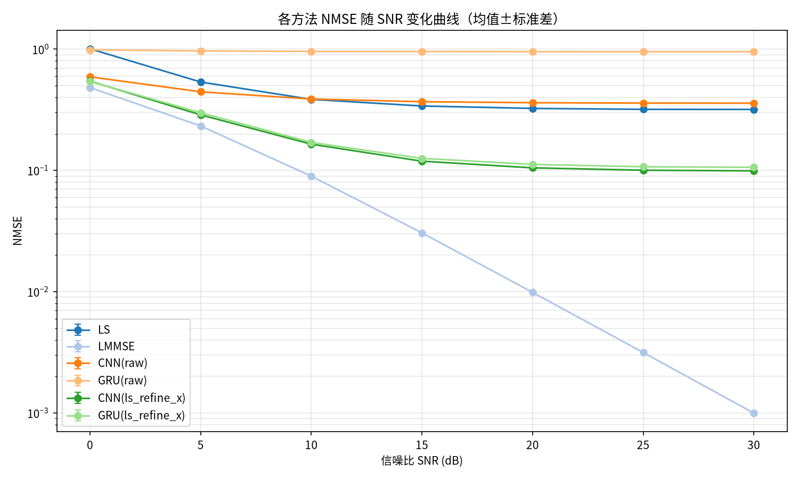
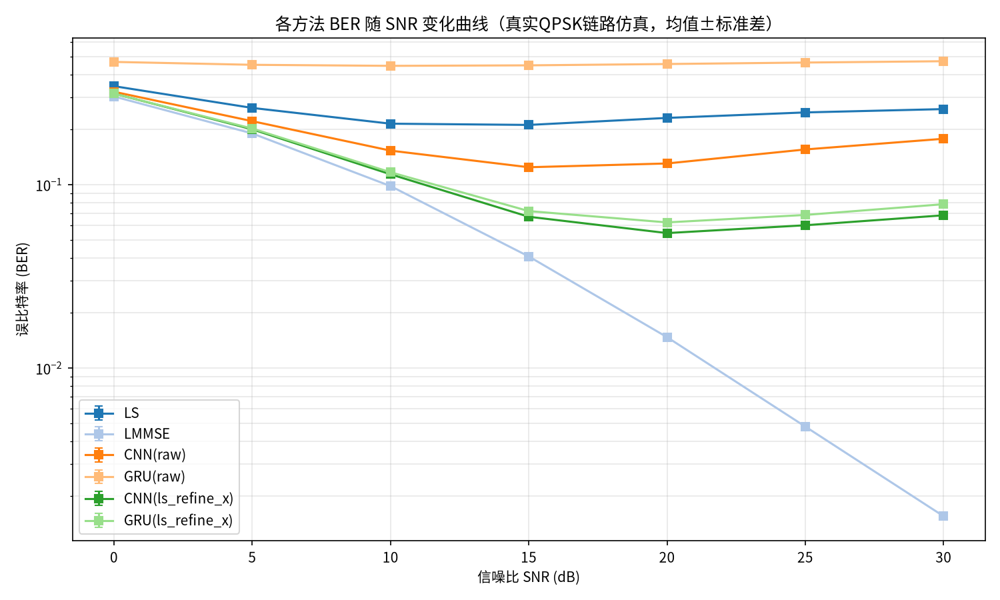
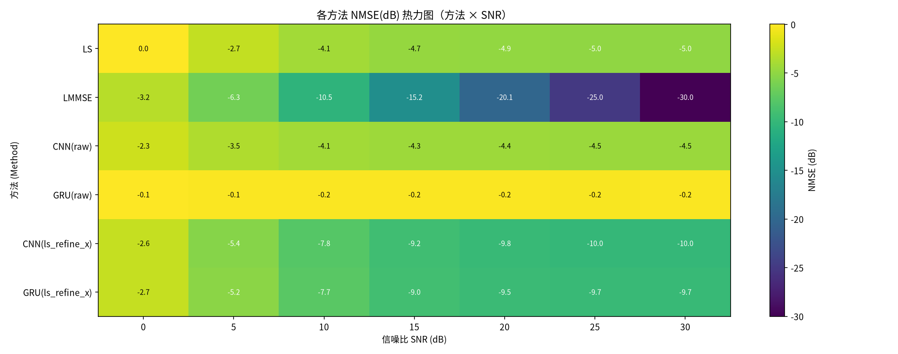
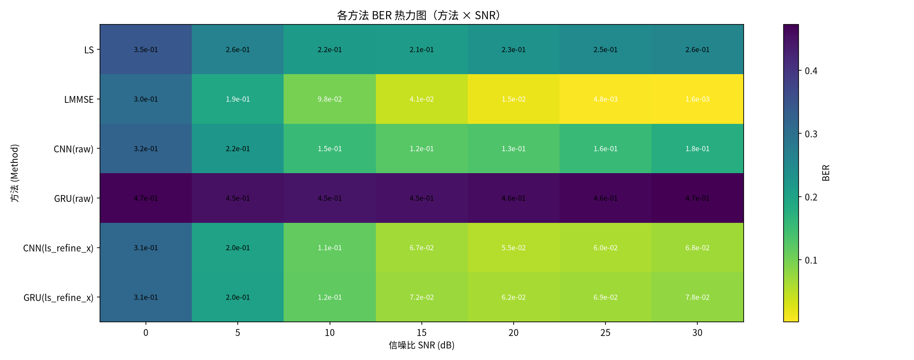

# 信道估计方法对比实验报告

- 生成时间：2026-10-17 22:04:34
- 实验名称：ofdm_freq_selective
- 随机种子：42

## 1. 实验配置

| 参数 | 值 |
|---|---|
| 信道类型 (Channel) | ofdm_freq_selective |
| MIMO 规模 | 4 发 × 4 收 |
| 导频长度 (Pilots) | 16 |
| SNR 扫描 | [0, 5, 10, 15, 20, 25, 30] dB |
| 训练池样本 | 10000 |
| 每点测试样本 | 1000 |
| Monte Carlo 次数 | 3 |
| BER 仿真符号数 | 50 |
| 均衡方式 | mmse |
| DL 输入模式 | raw, ls_refine_x |
| DL 模型 | CNN, GRU |
| 训练轮数 | 100 （早停 patience=10）|

## 2. 对比方法

**传统方法**：LS（最小二乘）、LMMSE（线性最小均方误差）、ML（最大似然，闭式解）

**深度学习方法**（各输入模式分别成组）：
- `ls_refine_x`：混合式：LS 估计 + 导频特征，网络可见噪声协方差信息（改进）
- `raw`：端到端块拼接：[Re(Y)|Im(Y)|Re(X)|Im(X)]（历史方式）

## 3. 结果总表

### 3.1 NMSE（均值±标准差，越小越好）

| 方法 | 0 dB | 5 dB | 10 dB | 15 dB | 20 dB | 25 dB | 30 dB |
|---|---|---|---|---|---|---|---|
| LS | 1.005e+00±6.9e-04 | 5.353e-01±2.4e-03 | 3.850e-01±2.7e-04 | 3.396e-01±2.3e-04 | 3.243e-01±2.8e-04 | 3.186e-01±1.6e-03 | 3.181e-01±1.6e-03 |
| LMMSE | 4.814e-01±1.3e-03 | 2.325e-01±4.2e-04 | 8.960e-02±3.7e-04 | 3.053e-02±5.8e-05 | 9.861e-03±1.4e-05 | 3.150e-03±5.7e-06 | 9.966e-04±4.9e-06 |
| CNN(raw) | 5.904e-01±1.5e-03 | 4.445e-01±8.3e-04 | 3.874e-01±9.2e-04 | 3.683e-01±2.3e-04 | 3.614e-01±8.5e-04 | 3.588e-01±1.0e-03 | 3.581e-01±4.7e-04 |
| GRU(raw) | 9.862e-01±1.0e-03 | 9.665e-01±1.4e-03 | 9.567e-01±8.2e-04 | 9.546e-01±1.5e-03 | 9.531e-01±1.4e-03 | 9.518e-01±1.3e-04 | 9.525e-01±1.6e-04 |
| CNN(ls_refine_x) | 5.444e-01±7.8e-04 | 2.868e-01±1.6e-04 | 1.644e-01±5.5e-04 | 1.191e-01±9.6e-05 | 1.049e-01±9.8e-04 | 1.003e-01±6.5e-04 | 9.906e-02±5.1e-04 |
| GRU(ls_refine_x) | 5.407e-01±1.3e-03 | 2.989e-01±3.2e-04 | 1.701e-01±2.6e-04 | 1.255e-01±4.3e-04 | 1.120e-01±7.9e-04 | 1.071e-01±9.5e-04 | 1.060e-01±7.9e-04 |

### 3.2 BER（真实QPSK链路仿真，均值±标准差，越小越好）

| 方法 | 0 dB | 5 dB | 10 dB | 15 dB | 20 dB | 25 dB | 30 dB |
|---|---|---|---|---|---|---|---|
| LS | 3.453e-01±2.3e-04 | 2.628e-01±4.0e-04 | 2.156e-01±6.4e-04 | 2.122e-01±5.2e-04 | 2.318e-01±1.0e-03 | 2.483e-01±1.4e-03 | 2.589e-01±1.1e-03 |
| LMMSE | 3.033e-01±6.1e-05 | 1.907e-01±4.1e-04 | 9.846e-02±4.3e-04 | 4.068e-02±1.3e-04 | 1.477e-02±2.2e-04 | 4.804e-03±1.8e-04 | 1.559e-03±3.1e-05 |
| CNN(raw) | 3.219e-01±2.0e-04 | 2.225e-01±6.6e-04 | 1.537e-01±6.0e-04 | 1.247e-01±2.9e-04 | 1.308e-01±7.2e-05 | 1.560e-01±3.1e-04 | 1.784e-01±7.9e-04 |
| GRU(raw) | 4.683e-01±9.9e-04 | 4.515e-01±1.6e-03 | 4.457e-01±4.0e-04 | 4.485e-01±8.2e-04 | 4.560e-01±1.2e-03 | 4.646e-01±1.5e-03 | 4.723e-01±5.9e-04 |
| CNN(ls_refine_x) | 3.146e-01±1.9e-04 | 2.009e-01±3.7e-04 | 1.142e-01±4.3e-04 | 6.698e-02±1.6e-04 | 5.456e-02±1.7e-04 | 6.019e-02±4.5e-04 | 6.822e-02±3.3e-04 |
| GRU(ls_refine_x) | 3.145e-01±1.7e-04 | 2.028e-01±2.9e-04 | 1.171e-01±2.6e-04 | 7.191e-02±2.2e-04 | 6.238e-02±2.5e-04 | 6.852e-02±9.1e-04 | 7.841e-02±4.2e-04 |

## 4. 结果图表









> 各模型的训练曲线见各模型目录下的 `results.png`；逐 epoch 指标见 `results.csv`。

## 5. 对比分析

### 5.1 各SNR下的最优方法（按NMSE）

| SNR (dB) | 最优方法 | NMSE |
|---|---|---|
| 0 | LMMSE | 4.814e-01 |
| 5 | LMMSE | 2.325e-01 |
| 10 | LMMSE | 8.960e-02 |
| 15 | LMMSE | 3.053e-02 |
| 20 | LMMSE | 9.861e-03 |
| 25 | LMMSE | 3.150e-03 |
| 30 | LMMSE | 9.966e-04 |

### 5.2 LMMSE 相对 LS 的 NMSE 增益

| SNR (dB) | LS NMSE | LMMSE NMSE | 增益 (dB) |
|---|---|---|---|
| 0 | 1.005e+00 | 4.814e-01 | +3.20 |
| 5 | 5.353e-01 | 2.325e-01 | +3.62 |
| 10 | 3.850e-01 | 8.960e-02 | +6.33 |
| 15 | 3.396e-01 | 3.053e-02 | +10.46 |
| 20 | 3.243e-01 | 9.861e-03 | +15.17 |
| 25 | 3.186e-01 | 3.150e-03 | +20.05 |
| 30 | 3.181e-01 | 9.966e-04 | +25.04 |

LMMSE 在低SNR（0 dB）处增益约 3.20 dB，在高SNR（30 dB）处增益约 25.04 dB——符合理论预期：LMMSE 利用信道统计先验，主要在低SNR区域优于LS，高SNR时二者趋于一致。

### 5.4 深度学习各输入模式对比

| SNR (dB) | 最优 ls_refine_x | NMSE | 最优 raw | NMSE |
|---|---|---|---|---|
| 0 | GRU(ls_refine_x) | 5.407e-01 | CNN(raw) | 5.904e-01 |
| 5 | CNN(ls_refine_x) | 2.868e-01 | CNN(raw) | 4.445e-01 |
| 10 | CNN(ls_refine_x) | 1.644e-01 | CNN(raw) | 3.874e-01 |
| 15 | CNN(ls_refine_x) | 1.191e-01 | CNN(raw) | 3.683e-01 |
| 20 | CNN(ls_refine_x) | 1.049e-01 | CNN(raw) | 3.614e-01 |
| 25 | CNN(ls_refine_x) | 1.003e-01 | CNN(raw) | 3.588e-01 |
| 30 | CNN(ls_refine_x) | 9.906e-02 | CNN(raw) | 3.581e-01 |

### 5.5 深度学习方法与传统方法的整体对比

- SNR=0 dB：最优DL方法 GRU(ls_refine_x)（NMSE 5.407e-01），最优传统方法 LMMSE（NMSE 4.814e-01），差距 +0.50 dB
- SNR=30 dB：最优DL方法 CNN(ls_refine_x)（NMSE 9.906e-02），最优传统方法 LMMSE（NMSE 9.966e-04），差距 +19.97 dB

## 6. 结论

1. **传统方法**：LMMSE 全部SNR点不劣于LS（增益 3.20~25.04 dB），低SNR优势明显，高SNR趋同（本信道口径下 ML 无闭式等价，未纳入）。
2. **深度学习方法**：全SNR平均表现最优的DL方法为 **CNN(ls_refine_x)**。
3. **DL vs 传统**：当前配置下 DL 方法尚未超过最优传统方法（高SNR处差 19.97 dB）。可尝试增大训练样本量/epoch、加深网络、或改用携带导频信息的混合式输入（ls_refine_x）缩小差距。
4. **方法论**：所有方法在相同测试数据、相同指标口径（复数域NMSE + 真实QPSK链路BER）下评估，每个SNR点独立重复多次并报告均值±标准差，结果具有统计意义。

## 7. 复现方法

```bash
pip install -r requirements.txt
python main.py --config src/config/default.yml
```
