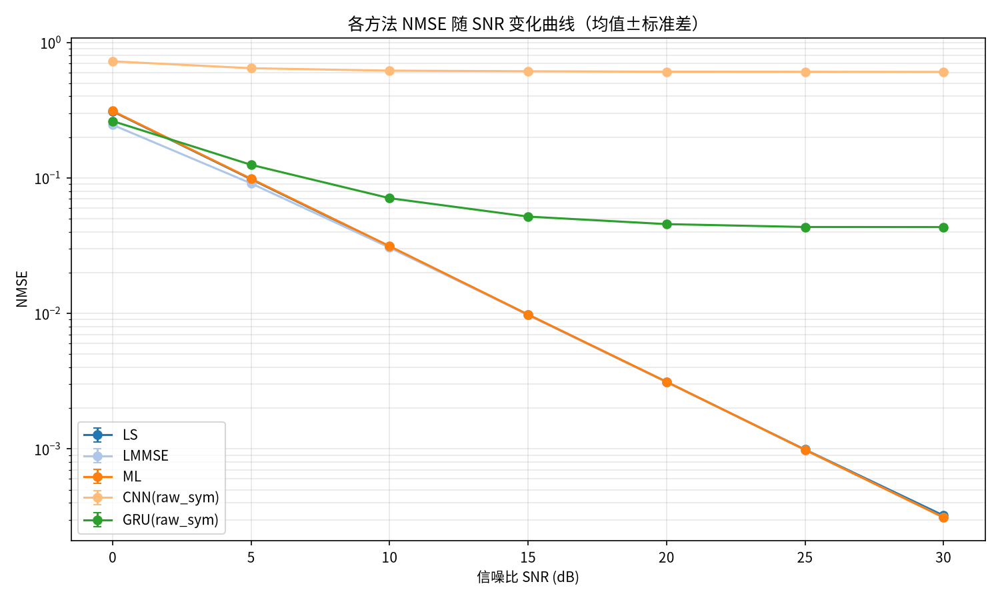
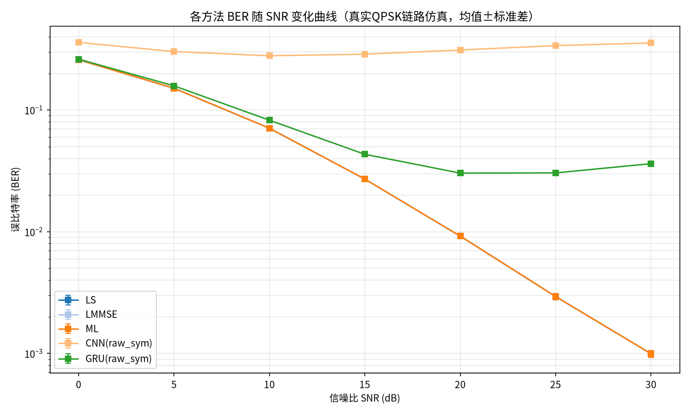
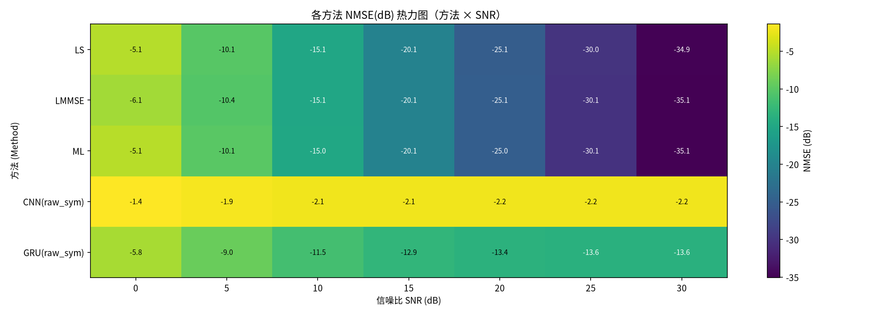
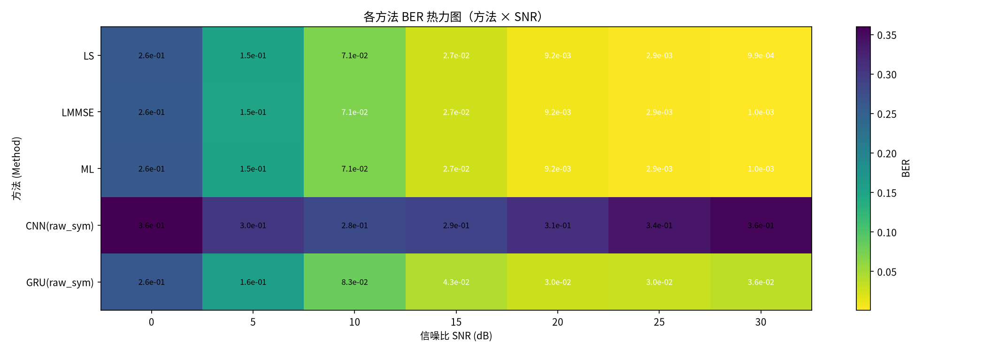

# 信道估计方法对比实验报告

- 生成时间：2026-10-17 22:26:59
- 实验名称：pilot_control_rawsym
- 随机种子：42

## 1. 实验配置

| 参数 | 值 |
|---|---|
| 信道类型 (Channel) | rayleigh |
| MIMO 规模 | 4 发 × 4 收 |
| 导频长度 (Pilots) | 16 |
| SNR 扫描 | [0, 5, 10, 15, 20, 25, 30] dB |
| 训练池样本 | 50000 |
| 每点测试样本 | 2000 |
| Monte Carlo 次数 | 3 |
| BER 仿真符号数 | 100 |
| 均衡方式 | mmse |
| DL 输入模式 | raw_sym |
| DL 模型 | CNN, GRU |
| 训练轮数 | 100 （早停 patience=10）|

## 2. 对比方法

**传统方法**：LS（最小二乘）、LMMSE（线性最小均方误差）、ML（最大似然，闭式解）

**深度学习方法**（各输入模式分别成组）：
- `raw_sym`：端到端按导频符号重排：每时间步 = (y, x) 配对（改进）

## 3. 结果总表

### 3.1 NMSE（均值±标准差，越小越好）

| 方法 | 0 dB | 5 dB | 10 dB | 15 dB | 20 dB | 25 dB | 30 dB |
|---|---|---|---|---|---|---|---|
| LS | 3.092e-01±1.8e-03 | 9.770e-02±5.6e-04 | 3.110e-02±1.5e-04 | 9.756e-03±3.3e-05 | 3.118e-03±2.5e-05 | 9.889e-04±5.7e-06 | 3.226e-04±2.7e-06 |
| LMMSE | 2.461e-01±1.2e-03 | 9.102e-02±5.2e-04 | 3.057e-02±1.4e-04 | 9.757e-03±3.5e-05 | 3.122e-03±2.4e-05 | 9.834e-04±6.3e-06 | 3.125e-04±2.3e-06 |
| ML | 3.116e-01±1.8e-03 | 9.847e-02±5.6e-04 | 3.133e-02±1.5e-04 | 9.816e-03±3.3e-05 | 3.129e-03±2.4e-05 | 9.842e-04±6.4e-06 | 3.125e-04±2.3e-06 |
| CNN(raw_sym) | 7.248e-01±2.6e-03 | 6.446e-01±1.9e-03 | 6.186e-01±2.4e-03 | 6.125e-01±3.7e-03 | 6.077e-01±4.0e-03 | 6.069e-01±8.8e-04 | 6.050e-01±8.2e-04 |
| GRU(raw_sym) | 2.625e-01±4.4e-04 | 1.248e-01±9.8e-04 | 7.081e-02±3.5e-04 | 5.181e-02±2.8e-04 | 4.559e-02±4.9e-04 | 4.341e-02±4.3e-04 | 4.335e-02±1.7e-04 |

### 3.2 BER（真实QPSK链路仿真，均值±标准差，越小越好）

| 方法 | 0 dB | 5 dB | 10 dB | 15 dB | 20 dB | 25 dB | 30 dB |
|---|---|---|---|---|---|---|---|
| LS | 2.590e-01±6.9e-04 | 1.509e-01±4.5e-04 | 7.086e-02±1.2e-04 | 2.707e-02±3.4e-04 | 9.202e-03±1.4e-04 | 2.935e-03±1.7e-04 | 9.944e-04±6.4e-05 |
| LMMSE | 2.579e-01±6.0e-04 | 1.504e-01±4.9e-04 | 7.070e-02±1.3e-04 | 2.704e-02±3.5e-04 | 9.203e-03±1.4e-04 | 2.936e-03±1.7e-04 | 9.958e-04±6.4e-05 |
| ML | 2.591e-01±6.8e-04 | 1.510e-01±4.6e-04 | 7.090e-02±1.1e-04 | 2.709e-02±3.5e-04 | 9.211e-03±1.4e-04 | 2.938e-03±1.7e-04 | 9.962e-04±6.5e-05 |
| CNN(raw_sym) | 3.597e-01±1.4e-03 | 3.021e-01±1.3e-03 | 2.793e-01±4.9e-04 | 2.878e-01±5.8e-04 | 3.114e-01±7.0e-04 | 3.385e-01±1.2e-03 | 3.555e-01±2.5e-03 |
| GRU(raw_sym) | 2.618e-01±6.3e-04 | 1.580e-01±5.6e-04 | 8.253e-02±1.6e-04 | 4.329e-02±1.7e-04 | 3.034e-02±5.0e-04 | 3.045e-02±1.6e-03 | 3.626e-02±4.4e-04 |

## 4. 结果图表









> 各模型的训练曲线见各模型目录下的 `results.png`；逐 epoch 指标见 `results.csv`。

## 5. 对比分析

### 5.1 各SNR下的最优方法（按NMSE）

| SNR (dB) | 最优方法 | NMSE |
|---|---|---|
| 0 | LMMSE | 2.461e-01 |
| 5 | LMMSE | 9.102e-02 |
| 10 | LMMSE | 3.057e-02 |
| 15 | LS | 9.756e-03 |
| 20 | LS | 3.118e-03 |
| 25 | LMMSE | 9.834e-04 |
| 30 | LMMSE | 3.125e-04 |

### 5.2 LMMSE 相对 LS 的 NMSE 增益

| SNR (dB) | LS NMSE | LMMSE NMSE | 增益 (dB) |
|---|---|---|---|
| 0 | 3.092e-01 | 2.461e-01 | +0.99 |
| 5 | 9.770e-02 | 9.102e-02 | +0.31 |
| 10 | 3.110e-02 | 3.057e-02 | +0.07 |
| 15 | 9.756e-03 | 9.757e-03 | -0.00 |
| 20 | 3.118e-03 | 3.122e-03 | -0.01 |
| 25 | 9.889e-04 | 9.834e-04 | +0.02 |
| 30 | 3.226e-04 | 3.125e-04 | +0.14 |

LMMSE 在低SNR（0 dB）处增益约 0.99 dB，在高SNR（30 dB）处增益约 0.14 dB——符合理论预期：LMMSE 利用信道统计先验，主要在低SNR区域优于LS，高SNR时二者趋于一致。

### 5.3 ML 与 LS

在线性高斯模型下，ML 与无正则 LS 严格等价（本框架 ML 采用闭式解），二者 NMSE 差异仅来自 LS 的对角加载正则化（SNR=15 dB 处相差 6.02e-05）。

### 5.5 深度学习方法与传统方法的整体对比

- SNR=0 dB：最优DL方法 GRU(raw_sym)（NMSE 2.625e-01），最优传统方法 LMMSE（NMSE 2.461e-01），差距 +0.28 dB
- SNR=30 dB：最优DL方法 GRU(raw_sym)（NMSE 4.335e-02），最优传统方法 LMMSE（NMSE 3.125e-04），差距 +21.42 dB

## 6. 结论

1. **传统方法**：LMMSE 全部SNR点不劣于LS（增益 -0.01~0.99 dB），低SNR优势明显，高SNR趋同；ML 与 LS 基本重合，与理论一致。
2. **深度学习方法**：全SNR平均表现最优的DL方法为 **GRU(raw_sym)**。
3. **DL vs 传统**：当前配置下 DL 方法尚未超过最优传统方法（高SNR处差 21.42 dB）。可尝试增大训练样本量/epoch、加深网络、或改用携带导频信息的混合式输入（ls_refine_x）缩小差距。
4. **方法论**：所有方法在相同测试数据、相同指标口径（复数域NMSE + 真实QPSK链路BER）下评估，每个SNR点独立重复多次并报告均值±标准差，结果具有统计意义。

## 7. 复现方法

```bash
pip install -r requirements.txt
python main.py --config src/config/default.yml
```
